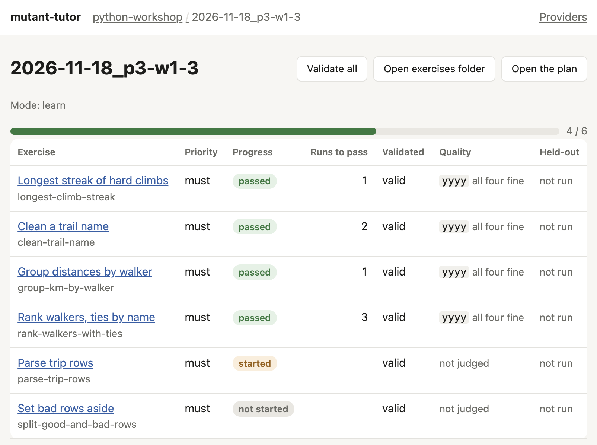
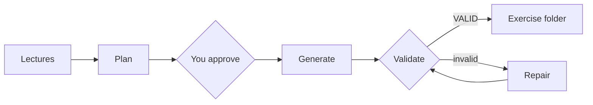

# mutant-tutor

[](https://github.com/markmak233/mutant-tutor/actions/workflows/ci.yml)

Turn your own course's lectures into programming exercises that you solve in your IDE
against automated tests, where **every exercise is checked by deterministic rules before you
see it**: the reference solution passes its tests, the empty skeleton fails them, every
planted bug (a mutant) is caught, and the reference agrees with an oracle written from the
question alone. No LLM judges whether an exercise is correct.



Everything runs on your machine. A local web GUI takes a course's lectures (PDFs or saved web
pages), its models and its environment; a LangGraph pipeline does the rest, and the exercises
land as folders you open in VS Code:



Courses in Python (plain Python, PySpark, MRJob) and, newly, C, whose first real batch came out
5 of 5 VALID; C++ and Java are planned.

It started as revision for a big data management course (none of its material is included)
and is built as an AI engineering portfolio project.

## What it does

- **Checked before you see it.** Five rules and a static API check, each tested against an
  exercise built to fail it ([how](docs/details.md#why-validation-comes-first)). 48 of 50
  generation runs ended VALID, 28 of them with no repair ([results](docs/details.md#results)).
- **An independent oracle.** A second model writes the oracle from the question alone, never
  seeing the reference, so a disagreement points at an ambiguous question as well as a wrong
  answer.
- **Hints that never show the answer.** `python -m tutor.hint` runs your tests and names a
  known mistake, or the planted mutant your code fails like.
- **Your models.** Any OpenAI-compatible model, or Claude through its own API, local or
  cloud, one per role (plan, generate, repair, oracle, ...); the GUI fills a model's settings
  from the public [models.dev](https://models.dev) list. With no API key, a coding assistant
  on a subscription can answer instead ([assistant mode](docs/assistant-mode.md)).
- **Generated code kept apart.** Each test run can start a fresh Docker container with no
  network and no view of your files ([where code runs](docs/details.md#where-exercise-code-runs)).
- **No retrieval needed, by measurement.** Hybrid RAG, an agent and a concept index were
  compared with sending the whole lecture, which stayed
  ([the comparison](docs/details.md#does-it-need-rag)).

## An exercise

You open `student.py`: the question in its docstring, a skeleton below. You run
`test_student.py`, and open `hints.md` only when stuck. What the validator needs (reference,
mutants, oracle) sits in a separate `solution/` folder. Seven synthetic examples, two of them
in C, are in [`examples/`](examples/), with lectures for two
[demo courses](docs/details.md#try-it-on-the-demo-courses).

## Quick start

Install [uv](https://docs.astral.sh/uv/getting-started/installation/), then from this checkout
with Python 3.11 already installed:

```bash
uv tool install --no-python-downloads --python 3.11 ".[gen,gui,doctor]"
tutor gui
```

The GUI manages courses, lectures, the models and keys every course shares (each course
chooses which model does what), and the environment, then plans and approves a batch. It
listens on 127.0.0.1 with a launch token; a second launch reuses the running server, and
`tutor shortcut` creates a desktop launcher. See
[installation and fresh-machine prerequisites](docs/setup/install.md). Docker is needed for
container courses; host big-data runs also need [Java/Hadoop](docs/setup/bigdata.md).

In an exercise folder, `tutor test` runs your tests in the course's container, so Java,
Hadoop or gcc can stay in the image ([options](docs/details.md#testing-your-work-in-the-course-image));
ordinary `pytest` still works. `tutor doctor` checks the setup and gives a next step for each
problem, changing nothing by default ([checks](docs/details.md#checking-your-setup)).

## Intended use

The aim is to help students understand their course topics better: the lecture material
you study from becomes exercises you can run, check and learn from at your own pace. It and
the exercises stay on your machine, in a per-course workspace outside any git repository;
only LLM calls (the slides' text and images, the generated code, and your code when you ask
a model for a hint) leave it. A personal project, not affiliated with any university or
course, provided as is (see [LICENSE](LICENSE)).

## Status

What exists today and what does not yet ([changes](CHANGELOG.md)):

| Part | Built | Planned |
|---|---|---|
| Validation | the five rules and the static API check above | |
| Generation | plan, approve, generate, validate, repair; Python (plain, PySpark, MRJob) and C | C++ and Java, when a course needs them |
| Checks after generation | held-out solutions, a judge of teaching quality; commands, and buttons on a batch's page | |
| Practice | exercises in VS Code, attempts recorded, hints (a command, and a tab on the exercise's page), `tutor test` in the container | |
| Retrieval | measured against the whole lecture, which stayed | |
| Install | uv and a wheel, `tutor gui`, `shortcut`, `doctor`; macOS, Linux (x64, arm64), Windows x64 | Windows on ARM, through x64 emulation |

- [`docs/details.md`](docs/details.md): how validation and generation work, the results, the
  RAG comparison, where exercise code runs, the layout and the roadmap
- [`docs/design/`](docs/design/README.md): every design decision, with the measurements behind it, one
  file per part (validation, generation, the GUI, ...) and an index
- [`docs/assistant-mode.md`](docs/assistant-mode.md): a coding assistant instead of an API

Developed with Claude Code as the coding assistant, in small reviewed steps; the working
rules are in [`CLAUDE.md`](CLAUDE.md) and [`AGENTS.md`](AGENTS.md).
